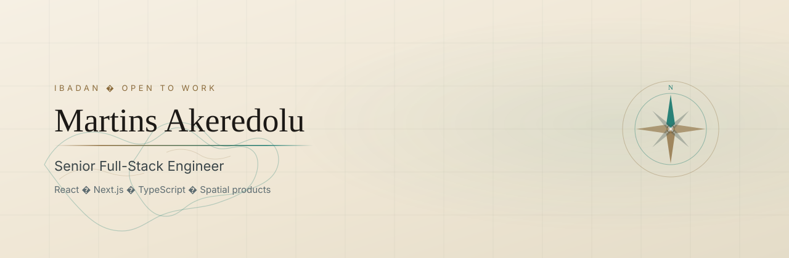

  <picture>
    <source media="(prefers-color-scheme: dark)" srcset="./assets/banner-dark.svg" />
    
  </picture>

  
  &nbsp;
  
  &nbsp;
  
  &nbsp;
  

  <picture>
    <source media="(prefers-color-scheme: dark)" srcset="./assets/rule-dark.svg" />
    
  </picture>

I'm **Martins**, a senior full-stack engineer based in Ibadan (I moved here from Lagos). I build product-shaped systems: interactive maps, live 3D allocation, multi-tenant platforms, and payment flows that have to work in more than one country.

Right now I work at **BeautyNBrushes**, on a React / Next.js / TypeScript / Express stack. Before that I owned frontend across Myxellia's real estate platforms, including an interactive 3D unit picker, and shipped a social product used by 10,000+ people.

I like books, maps, and software that feels like a place you can walk around in.

## Building ansa

**[ansa](https://ansa.africa)** is the company I founded and run. It started with a simple observation: everyday life in Nigeria runs on a dozen disconnected things. You sell on WhatsApp, take payment in one app, find a rider in another, and keep the record in your head. ansa brings those everyday jobs together.

The idea is **one ansa account that works across every ansa product**. You sign up once, and each new product you use already knows you, with your approval and nothing more. We are starting in Nigeria and building it to travel across Africa.

Every product answers a question people already ask:

| Product | The question | Where it is |
| --- | --- | --- |
| **ansa Business** | *How do I sell without building a website?* | Opening first |
| **ansa shop** | *Where can I buy from sellers I can trust?* | [Open](https://shop.ansa.africa) |
| **ansa delivery** | *How do I get this across town today?* | Opening first |
| **ansa careers** | *Who is hiring for work like mine?* | Coming soon |
| **ansa home** | *Who can fix my sink this afternoon?* | Coming soon |

**What we've built so far**

- **ansa Business:** run a whole business from your phone. Products, orders, customers and money sit in one place, with a shop page of your own that's ready in minutes and easy to share wherever you already talk to buyers. Send invoices and receipts straight into a chat, and see what sold, who bought and what you're owed.
- **ansa shop:** every business on ansa gets a storefront. Buyers check out in about a minute with no account, follow each order from a private link, and get WhatsApp updates only if they ask for them.
- **ansa delivery:** send a package and know where it is the whole way, with proof at pickup and proof at the door. It plugs straight into ansa Business orders, and riders can start work from a link without installing anything first.
- **One experience everywhere:** a native mobile app plus web apps you can install from the browser, all sharing one design, working in light and dark, and laid out for any screen from a small phone to a desktop.

Privacy is part of the product, not an afterthought. We collect only what a feature needs, show prices and terms before anyone pays, and never message people who haven't agreed to hear from us.

<code>React Native</code> · <code>Expo</code> · <code>Next.js</code> · <code>TypeScript</code> · <code>Node.js</code> · <code>PostgreSQL</code>

## Open to work

I'm looking for **senior full-stack or frontend** roles where I can own a product surface end to end: spatial / 3D UI, payments and subscriptions, multi-tenant SaaS, or high-craft web apps.

**[Portfolio](https://aboutmartins.vercel.app)** · **[LinkedIn](https://www.linkedin.com/in/martins-akeredolu)** · **[Email](mailto:olamideakeredolu@gmail.com)** · **[X](https://x.com/_raelmartins)** · **[Medium](https://medium.com/@olamideakeredolu)**

## Now

At BeautyNBrushes I moved a legacy product onto a modern stack (Railway), then built the systems around it: multi-region payments with Stripe and Paystack, seat-based subscription billing, a location-based marketplace, and an A/B testing dashboard in the admin suite.

## Featured

<table>
  <tr>
    <td width="50%" valign="top">
      <h3><a href="https://github.com/raelMartins/myxellia-3d-real-estate">3D unit allocation</a></h3>
      
Investors walk a building, inspect units, and reserve them inside a live 3D model. Built for Myxellia's multi-tenant real estate stack: the kind of spatial UI that has to stay fast and honest.

      
<code>Next.js</code> · <code>TypeScript</code> · <code>WebGL</code>

    </td>
    <td width="50%" valign="top">
      <h3><a href="https://github.com/raelMartins/realm-lore-engine">Realm Lore Engine</a></h3>
      
A schema-driven campaign map: pan, zoom, lore drawers, secrets, and a dual-isle atlas that reacts when an alliance is forged. Content is data. The cartography is the product.

      
<code>Next.js</code> · <code>TypeScript</code> · <code>Turso</code>

    </td>
  </tr>
  <tr>
    <td width="50%" valign="top">
      <h3><a href="https://socksmith.vercel.app">Socksmith</a></h3>
      
Launch waitlist and 3D product gallery for a sock brand: styles, colours, box quantities, and an admin insight layer on top of Redis.

      
<code>Next.js</code> · <code>Three.js</code> · <code>Redis</code>

    </td>
    <td width="50%" valign="top">
      <h3><a href="https://ultimatedraughts.netlify.app">Ultimate Draughts</a></h3>
      
A draughts game I built because I missed playing. Still my favourite personal project: small, complete, and made for the joy of it.

      
<code>React</code> · <code>Context</code> · <code>Hooks</code>

    </td>
  </tr>
</table>

## Stack

  

I spend most days in **React, Next.js, and TypeScript**, with Node / Express when I own the server, and WebGL when the interface needs to be a space instead of a form. Payments (Stripe, Paystack), multi-tenant architecture, and AI-augmented workflows (Cursor) are part of how I ship.

## Elsewhere

- Site: [aboutmartins.vercel.app](https://aboutmartins.vercel.app)
- ansa: [ansa.africa](https://ansa.africa)
- Writing: [medium.com/@olamideakeredolu](https://medium.com/@olamideakeredolu)
- Work history and case notes live on the [portfolio](https://aboutmartins.vercel.app)
